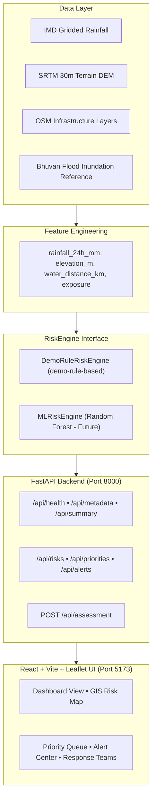

# Intelligent Disaster Risk Management and Emergency Response System

> **Predict Early. Identify Risk. Alert in Time. Respond Faster.**

An intelligent, data-driven decision-support platform combining **Rule-Based Risk Classification, Early Warning Alerts, Interactive Leaflet GIS Visualization, and Emergency-Response Triage** into one operational command workflow.

---

## ⚠️ DEMO MODE & RESPONSIBLE USE DISCLAIMER

> **DEMO MODE NOTICE:** The current platform demonstrates the complete end-to-end software pipeline using illustrative sample records in **Odisha, India** and a transparent, deterministic rule-based engine (`demo-rule-based`). Real Machine Learning model predictions (e.g. Random Forest baseline) will replace the demo engine once the research dataset and prediction target definitions are finalized.

### Operational Boundaries
- The system is a **decision-support tool** for human operators.
- It is **NOT** an official disaster-warning authority.
- It does **NOT** replace civil engineers, state emergency management authorities, or field inspection teams.

---

## Key Features

- **Interactive Command Center Dashboard:** Dark-theme GIS interface displaying real-time KPI metrics (Monitored Assets, Critical Risk, High Risk, Open Alerts).
- **Interactive Leaflet GIS Risk Map:** Real-time marker selection, popups, risk level color coding, zoom/pan support, selection highlighting, and risk-level filtering.
- **Dynamic Scenario Selector:** Switch between *Extreme Rainfall*, *Flood-related Conditions*, and *Baseline Monitoring* scenarios to observe real-time risk score shifts.
- **Inspection Priority Queue:** Assets ordered dynamically by combined risk score and asset exposure index.
- **Early Warning Alert Center:** Real-time alert notifications linked directly to affected infrastructure assets.
- **Emergency Response Planning Support:** Practical operational workflow stages, critical asset counts, inspection sequencing, and simulated team roster assignments.
- **Interactive Risk Engine Tester:** Built-in calculation tool allowing live evaluation of custom rainfall, elevation, water proximity, and exposure parameters via `POST /api/assessment`.
- **Offline Local Fallback:** Graceful fallback to local demo mode if backend API connectivity is interrupted.

---

## System Architecture



For detailed sequence diagrams and pipeline architectures, see [docs/architecture/DIAGRAM.md](file:///c:/Users/chandan2005/Desktop/intelligent-disaster-risk-management/intelligent-disaster-risk-management/docs/architecture/DIAGRAM.md).

---

## Transparent Demo Risk Engine (`demo-rule-based`)

Risk scores are computed transparently using normalized components clamped between `[0, 1]`:

$$\text{rainfall\_comp} = \min\left(\frac{\text{rainfall\_24h\_mm}}{200.0}, 1.0\right)$$
$$\text{elevation\_comp} = 1.0 - \min\left(\frac{\max(\text{elevation\_m}, 0)}{100.0}, 1.0\right)$$
$$\text{water\_comp} = 1.0 - \min\left(\frac{\max(\text{water\_distance\_km}, 0)}{5.0}, 1.0\right)$$
$$\text{exposure\_comp} = \text{clamp}(\text{exposure}, 0.0, 1.0)$$

$$\text{Risk Score} = 0.40 \cdot \text{rainfall\_comp} + 0.20 \cdot \text{elevation\_comp} + 0.20 \cdot \text{water\_comp} + 0.20 \cdot \text{exposure\_comp}$$

### Risk Classification
- **CRITICAL:** $\ge 0.85$ (Immediate field team inspection within 2 hours)
- **HIGH:** $\ge 0.65$ (Inspection within 6 hours)
- **MODERATE:** $\ge 0.35$ (Routine monitoring)
- **LOW:** $< 0.35$ (Standard periodic review)

$$\text{Priority Score} = 0.85 \cdot \text{Risk Score} + 0.15 \cdot \text{exposure\_comp}$$

---

## FastAPI Backend Endpoints

| Method | Endpoint | Description |
|---|---|---|
| `GET` | `/api/health` | Service health status and engine mode |
| `GET` | `/api/metadata` | System version, research scope, and engine type |
| `GET` | `/api/summary` | KPI summary metrics (monitored assets, critical/high counts, open alerts) |
| `GET` | `/api/risks` | List of assessed infrastructure assets (query by `risk_level`, `scenario`) |
| `GET` | `/api/risks/{risk_id}` | Detailed assessment for a specific asset |
| `GET` | `/api/priorities` | Infrastructure assets ordered by `priority_score` descending |
| `GET` | `/api/alerts` | Active early warning system notifications |
| `POST` | `/api/assessment` | Custom risk calculation endpoint using Pydantic input schema |

---

## Running the Application Locally

### Prerequisites
- **Python 3.10+**
- **Node.js 18+**

### 1. Start the FastAPI Backend
```bash
# Navigate to backend directory
cd backend

# Install Python requirements
pip install -r requirements.txt

# Start Uvicorn dev server
python -m uvicorn app.main:app --reload --host 127.0.0.1 --port 8000
```
Backend API will be running at `http://127.0.0.1:8000`. Test interactive docs at `http://127.0.0.1:8000/docs`.

### 2. Start the React Frontend
```bash
# Navigate to frontend directory
cd frontend

# Install Node dependencies (if needed)
npm install

# Start Vite development server
npm run dev
```
Open `http://localhost:5173` in your browser.

---

## Running Automated Tests & Production Build

### Run Backend Tests (pytest)
```bash
python -m pytest backend/tests
```

### Run Frontend Production Build
```bash
cd frontend
npm run build
```

---

## Dataset & ML Roadmap

1. **Dataset Ingestion:**
   - Spatial feature alignment across IMD rainfall grids, SRTM 30m DEM rasters, and OpenStreetMap Odisha infrastructure lines.
   - Historical flood inundation masks from ISRO Bhuvan/NRSC.
2. **Machine Learning Model Pipeline:**
   - **Baseline Model:** Random Forest Classifier & Regressor (CPU-friendly for low-spec development machines).
   - **Advanced Model:** XGBoost (if experiments show statistically significant ROC-AUC gain).
3. **Leakage Prevention:**
   - Spatial train/val/test splits by river sub-basin to prevent geographic data leakage.
   - Strict temporal separation of antecedent rainfall feature windows.
4. **Evaluation Metrics:**
   - ROC-AUC, PR-AUC, Precision, Recall, F1-Score, and probability calibration curves.

---

## Project Team

**Department of Computer Science and Engineering**  
**Academic Year: 2026–27**

- KATTARI PRINCY VENEELA
- CHANDAN KUMAR SAH TELI
- CHINTHA SWAPNA
- ALLAM B V ESWARA SAI

**Guide:** JYOTHULA VIDYA, Asst. Professor
