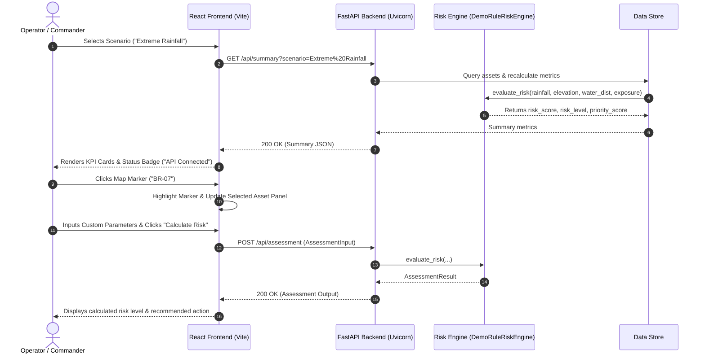
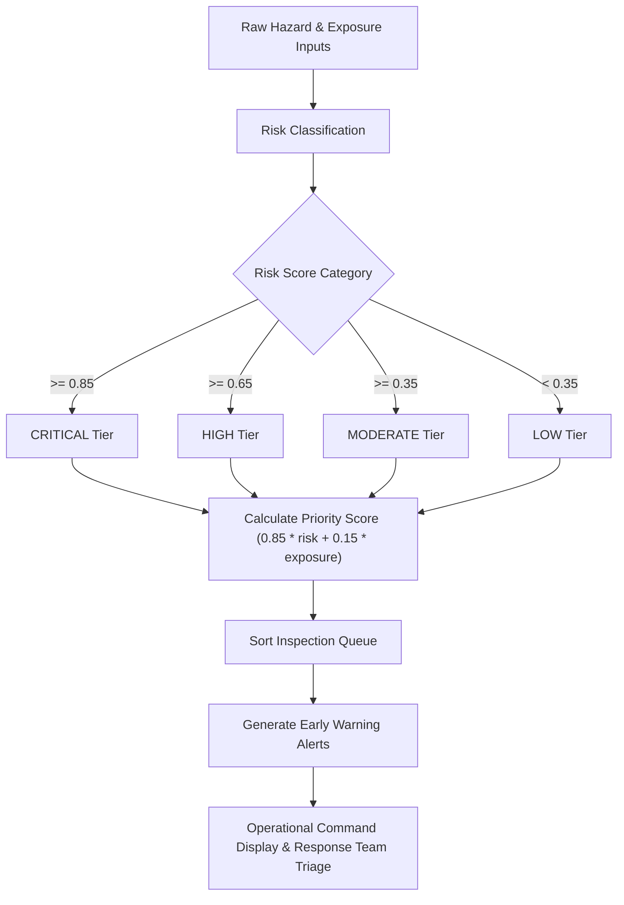

# System Architecture & Workflow Diagrams

This document outlines the software architecture, data pipelines, backend APIs, and decision-support workflows for the **Intelligent Disaster Risk Management and Emergency Response System**.

---

## 1. End-to-End Architecture

```mermaid
flowchart TB
    subgraph DATA_LAYER["Data Sources & Ingestion"]
        A1["IMD Gridded Rainfall"]
        A2["SRTM 30m DEM"]
        A3["OSM Infrastructure Layers"]
        A4["Bhuvan NRSC Flood Reference"]
    end

    subgraph PIPELINE["Preprocessing & Alignment"]
        B1["Spatial Join & Coordinate Normalization"]
        B2["Feature Extraction (rainfall, elevation, water_distance, exposure)"]
        B3["Validation & Leakage Control"]
    end

    subgraph ENGINE_LAYER["Risk Engine Interface (RiskEngine)"]
        C1["DemoRuleRiskEngine (demo-rule-based)"]
        C2["MLRiskEngine (Random Forest / XGBoost Baseline - Future)"]
    end

    subgraph BACKEND_LAYER["FastAPI REST API"]
        D1["GET /api/health"]
        D2["GET /api/summary"]
        D3["GET /api/risks & /api/risks/{id}"]
        D4["GET /api/priorities"]
        D5["GET /api/alerts"]
        D6["POST /api/assessment"]
    end

    subgraph FRONTEND_LAYER["React Command Center Dashboard"]
        E1["Geospatial Leaflet Risk Map"]
        E2["Dynamic Selected Asset Panel"]
        E3["Inspection Priority Ranking Queue"]
        E4["Early Warning Alert Center"]
        E5["Response Team Planning Support"]
    end

    DATA_LAYER --> PIPELINE
    PIPELINE --> ENGINE_LAYER
    ENGINE_LAYER --> BACKEND_LAYER
    BACKEND_LAYER --> FRONTEND_LAYER
```

---

## 2. Frontend / Backend Architecture

---

## 3. Data-to-ML Pipeline Architecture

```mermaid
flowchart LR
    subgraph RAW["Raw Data Ingestion"]
        R1["Rainfall Grids"]
        R2["Terrain Rasters"]
        R3["Vector Assets"]
    end

    subgraph PREP["Data Cleaning & Alignment"]
        P1["Reproject to EPSG:4326"]
        P2["Calculate Euclidean Proximity"]
        P3["Spatial Train/Test Split (Prevent Leakage)"]
    end

    subgraph MODEL["Model Development"]
        M1["Random Forest Classifier / Regressor"]
        M2["Cross-Validation & Geographic Evaluation"]
        M3["Metrics: ROC-AUC, PR-AUC, F1-Score"]
    end

    subgraph DEPLOY["Model Serving"]
        D1["Export Model Artifact (.pkl / .onnx)"]
        D2["Pluggable MLRiskEngine Interface"]
    end

    RAW --> PREP
    PREP --> MODEL
    MODEL --> DEPLOY
```

---

## 4. Decision-Support Pipeline Architecture

